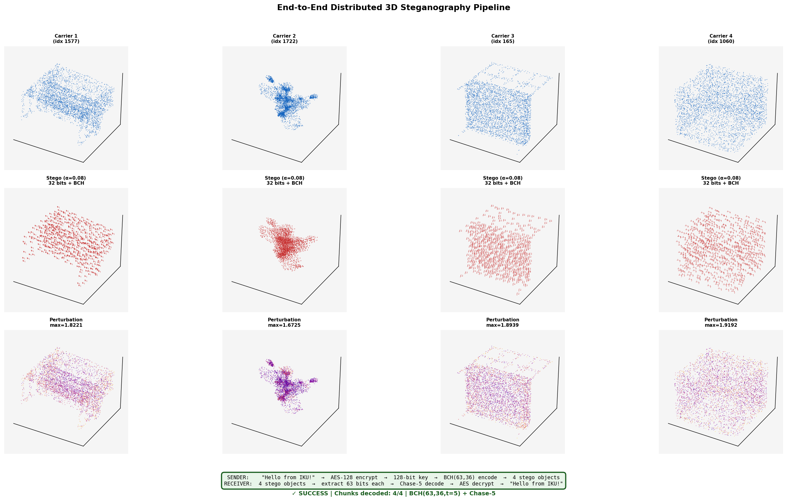
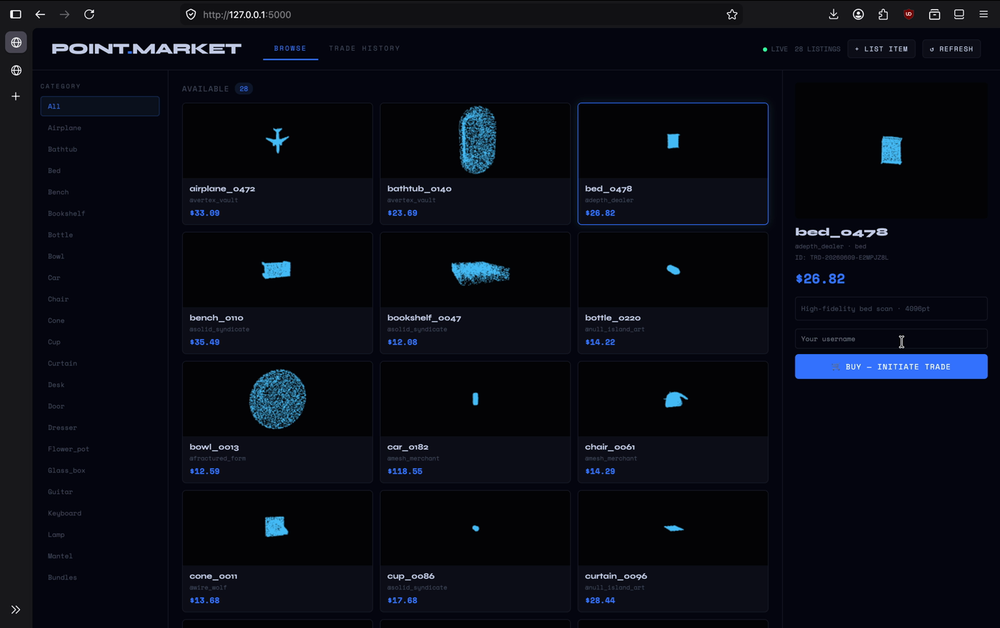
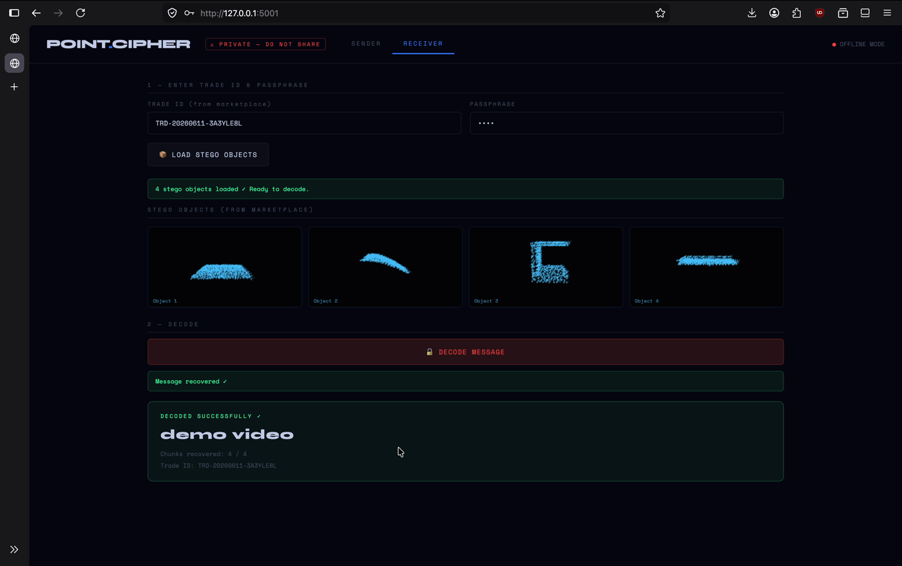
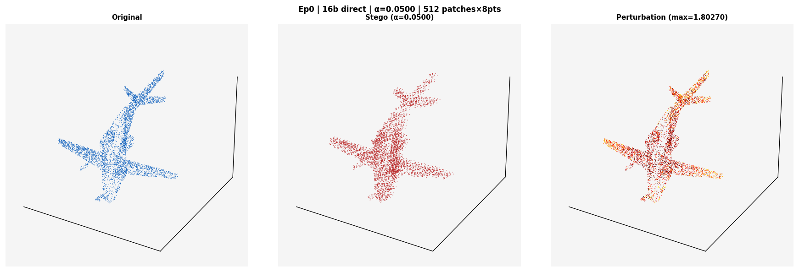
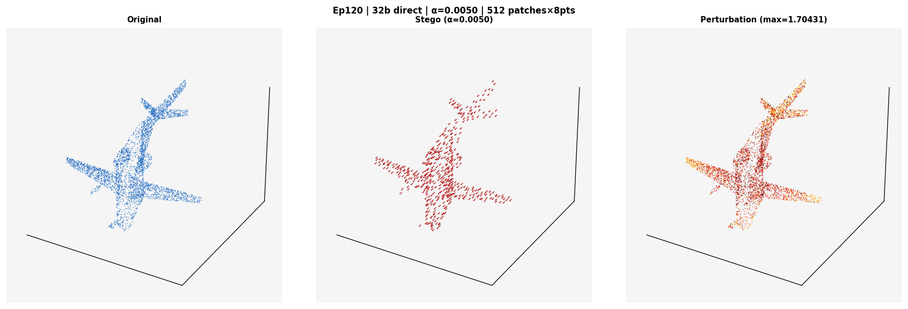
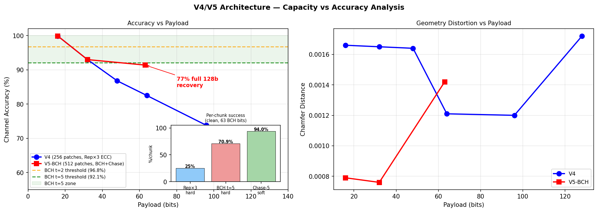

# Invisible Data Embedding in 3D Point Clouds via Deep Neural Networks

A deep-learning steganography system that hides an **encrypted 128-bit message inside ordinary-looking 3D models**.
The message is encrypted with AES, protected with a BCH error-correcting code, split into four parts, and each
part is embedded into a different 4096-point cloud by a PointNet++/FiLM network. The four "stego" objects can then
be published as an innocent asset bundle on a (mock) 3D model marketplace. Only someone who knows the trade ID
and the shared passphrase can recover the message.

> The model was trained on Google Colab GPUs; the demo apps and tests run locally on CPU.

<p align="center">
  
</p>

---

## Table of contents

1. [What it does](#what-it-does)
2. [Results at a glance](#results-at-a-glance)
3. [Repository layout](#repository-layout)
4. [Quick start (demo apps)](#quick-start-demo-apps)
5. [System design](#system-design)
   - [Pipeline](#pipeline)
   - [Cryptographic layer](#1-cryptographic-layer)
   - [Error-correction layer](#2-error-correction-layer-bch6336-t5--chase-decoding)
   - [Distributed embedding](#3-distributed-embedding-4--32-bits)
   - [Neural network](#4-neural-network-stegov5bch)
6. [How the model was trained](#how-the-model-was-trained)
7. [Development history: how we got here](#development-history-how-we-got-here)
8. [Key design decisions](#key-design-decisions)
9. [Evaluation](#evaluation)
10. [Tests](#tests)
11. [Limitations and future work](#limitations-and-future-work)

---

## What it does

| Role | App | What happens |
|---|---|---|
| **Sender** | `POINT.CIPHER` (port 5001) | Picks 4 carrier models from ModelNet40, types a secret message (≤ 16 bytes) and a passphrase. The message is encrypted, BCH-encoded, embedded into the 4 models and listed on the marketplace as a normal "bundle". The sender gets a **trade ID** (`TRD-YYYYMMDD-XXXXXXXX`). |
| **Public** | `POINT.MARKET` (port 5000) | A marketplace of 3D models. Regular listings and stego bundles look the same. Anyone can browse, preview the point clouds in 3D (drag to rotate) and "buy". |
| **Receiver** | `POINT.CIPHER` → Receiver tab | Enters the trade ID and the passphrase. The 4 objects are loaded, the bits are extracted by the network, error-corrected and decrypted. |

| Marketplace (public) | Cipher tool: receiver decoding the message |
|---|---|
|  |  |

A full screen recording of the demo (recorded with an earlier version of the UI) is in [`docs/demo.mp4`](docs/demo.mp4).

## Results at a glance

Final model (`models/model.pth`), α = 0.08, 500 random 128-bit messages (2000 embedded objects) from the ModelNet40 test split:

| Metric (no attack) | Value |
|---|---|
| Raw channel bit accuracy (63 bits / object) | **92.0 %** |
| Chunk success, BCH t=5 hard decoding | 75.4 % |
| Chunk success, **Chase-5 soft decoding** | **93.8 %** |
| **Full 128-bit message recovery** (all 4 chunks correct) | **80.6 %** |
| Mean Chamfer distance (original vs. stego) | 0.00142 |

The full attack table, including the weak spots, is in [Evaluation](#evaluation).

## Repository layout

```
.
├── app/                        # Flask demo applications
│   ├── cipher_server.py        #   sender/receiver tool (model inference, crypto, BCH)  :5001
│   ├── marketplace_server.py   #   public 3D model marketplace                         :5000
│   ├── templates/              #   single-page UIs (canvas point-cloud viewers, no build step)
│   └── data/                   #   runtime state: listings.json, history.json, objects/*.npy (git-ignored)
├── models/
│   └── model.pth               # final trained weights (StegoV5BCH, 3 MB)
├── training/                   # Google Colab scripts used to train / evaluate the model
│   ├── train.py                #   main training loop (curriculum 16 → 34 → 63 bits)
│   ├── finetune_decoder.py     #   frozen-encoder fine-tune of the message decoder
│   ├── evaluate.py             #   robustness evaluation (BCH t=5 + Chase-5)
│   └── requirements.txt
├── tests/
│   ├── test_cavp_validation.py #   known-answer tests against RFC 3686 / 4231 / 6070 / 1321
│   ├── run_tests.py            #   crypto, trade-ID, BCH, pipeline, statistics, geometry, model
│   ├── nist_tests.py           #   NIST SP 800-22 randomness tests on ciphertext and keys
│   └── test_embed_pipeline.py  #   smoke test of AES → BCH → model.embed using the app code
├── results/                    # raw evaluation outputs (.npy dicts) referenced below
├── docs/
│   ├── images/                 # training snapshots, analysis plots, UI screenshots
│   └── demo.mp4                # screen recording of the demo
├── data/ModelNet40/            # dataset goes here (not versioned, see below)
└── requirements.txt
```

## Quick start (demo apps)

**Requirements:** Python 3.10+ (tested with 3.13). A GPU is not needed: embedding a bundle takes about 6–12 s on a laptop CPU.

```bash
git clone <this-repo>
cd <this-repo>
python -m venv venv && source venv/bin/activate
pip install -r requirements.txt
```

**Dataset (optional but recommended).** Download [ModelNet40](https://modelnet.cs.princeton.edu/) (the
`ModelNet40.zip` with `.off` meshes, about 9 GB unpacked) and extract it so that the category folders are at
`data/ModelNet40/<category>/{train,test}/*.off`. You can also point to an existing copy:

```bash
export MODELNET_DIR=/path/to/ModelNet40
```

Without the dataset both apps still start. The cipher tool falls back to random point clouds, and the marketplace
generates synthetic procedural shapes.

**Run** both servers, each in its own terminal:

```bash
python app/marketplace_server.py   # http://localhost:5000
python app/cipher_server.py        # http://localhost:5001
```

Optional environment variables:

| Variable | Default | Purpose |
|---|---|---|
| `MODELNET_DIR` | `data/ModelNet40` | dataset location |
| `MODEL_PATH` | `models/model.pth` | weights used by the cipher tool |
| `PORT` | `5000` / `5001` | port of the server being started. On macOS, AirPlay Receiver already listens on 5000: run the marketplace with `PORT=5050` or turn AirPlay Receiver off. |
| `HOST` | `127.0.0.1` | marketplace bind address (`0.0.0.0` to demo across devices on a LAN) |
| `FLASK_DEBUG` | off | set to `1` for the Flask debugger (never on a public interface) |

**Try it:** open the cipher tool, pick 4 objects → *Preview* → enter a message and passphrase →
*Encrypt · Embed · List*. The bundle appears on the marketplace. Copy the trade ID, switch to the
*Receiver* tab, paste the trade ID and passphrase → *Decode*.

---

## System design

### Pipeline

```
SENDER
 "Hello from 3D!"  (≤16 bytes UTF-8)
        │  PBKDF2-HMAC-SHA256(passphrase, salt = trade ID, 10 000 it.) → 128-bit key
        ▼  AES-128-CTR (nonce = MD5(trade ID)[:8])
 128 ciphertext bits
        │  split into 4 × 32 bits, append 2-bit chunk ID + 2 zero pad bits = 36 bits
        ▼  BCH(63,36) systematic encoding
 4 × 63-bit codewords
        │  StegoV5BCH.embed(point_cloud_i, codeword_i, α = 0.08)   (+ 28 filler clouds, see below)
        ▼
 4 stego point clouds (4096 × 3 each) → listed on the marketplace under the trade ID

RECEIVER
 4 stego clouds ─► StegoV5BCH.extract ─► 4 × 63 logits
        │  hard bits + |logit| confidences
        ▼  Chase-5 soft decoding around a Berlekamp–Massey BCH(63,36,t=5) decoder
 4 × 36 bits ─► check chunk IDs ─► 128 bits ─► AES-128-CTR decrypt ─► plaintext
```

### 1. Cryptographic layer

- **Key derivation:** `PBKDF2-HMAC-SHA256(passphrase, salt = trade_id, 10 000 iterations)`, truncated to 16 bytes (AES-128).
  Using the trade ID as the salt gives every bundle a different key even when the passphrase is reused.
- **Cipher:** AES-128 in **CTR mode**. CTR is a stream cipher, so the ciphertext has the same length as the message.
  A 16-byte message gives exactly 128 bits with no padding block. This keeps the payload small, which matters
  because every extra bit costs embedding accuracy.
- **Nonce:** first 8 bytes of `MD5(trade_id)`. It is deterministic, so the receiver needs nothing beyond the trade
  ID, and it is unique per bundle because trade IDs are random.
- **Why encrypt at all?** Ciphertext is statistically indistinguishable from random bits (confirmed by the NIST
  tests). The bits the network embeds therefore carry no structure that could reveal the message. It also means a
  wrong passphrase produces garbage, not a partial message.

### 2. Error-correction layer: BCH(63,36, t=5) + Chase decoding

The neural channel is noisy (about 8 % bit errors per object), so raw bits are not enough.

- **Code:** binary BCH over GF(2⁶) with primitive polynomial x⁶ + x + 1. The generator is the product of the
  minimal polynomials of α¹, α³, α⁵, α⁷, α⁹ (degree 27), giving n = 63, k = 36, and it corrects **up to t = 5
  errors** per codeword.
- **Decoder:** syndrome computation → **Berlekamp–Massey** (error-locator polynomial) → **Chien search** (error
  positions). The result is verified by recomputing the remainder.
- **Chase-5 soft decoding:** the network outputs logits, not just bits. Chase takes the 5 bits with the
  smallest |logit| (the least confident ones), tries all 2⁵ = 32 flip patterns and runs the BCH decoder on each
  candidate. This raised per-chunk success from **75.4 % to 93.8 %** at no training cost.
- **Chunk IDs:** each 36-bit word holds 32 payload bits plus a 2-bit chunk index. A decoded chunk whose ID does
  not match its position is rejected. This catches mis-corrections and object reordering.

### 3. Distributed embedding (4 × 32 bits)

One point cloud could not carry 128 bits reliably (see the [capacity analysis](#capacity-vs-accuracy)), so the
message is **spread over four objects**. Each object carries one 63-bit codeword (32 data bits). At 63 channel
bits the network's accuracy (about 92 %) sits right at BCH t = 5's correction threshold (92.1 %). Four objects also fit the
"asset bundle" cover story on the marketplace.

### 4. Neural network: `StegoV5BCH`

An encoder–extractor network that **regenerates** the point cloud with the message woven into the local geometry.

```
           ┌────────────── shared PointNet++ backbone ──────────────┐
 input     │ SA1: FPS 1024 centroids, r=0.1, k=32, MLP 3→64→64→128   │
 4096×3 ──►│ SA2: FPS  512 centroids, r=0.2, k=32, MLP 131→128→128→256│──► 512 patch features (256-d)
           └─────────────────────────────────────────────────────────┘
                                   │
 message (63 bits) ─► FiLM: Linear 63→256→512 → (γ, β);  feat' = γ ⊙ feat + β
                                   │
             Alpha-bounded patch decoder: Conv1d 256→512→256→24 per patch
             → 8 points per patch, offset = α · tanh(raw / α), added to the patch centroid
                                   │
                         stego cloud: 512 patches × 8 = 4096 points

 EXTRACT:  stego ─► same SA1/SA2 ─► msg_decoder (Conv1d 256→512→256→63, BN+GELU)
           per patch ─► mean over the 512 patches ─► 63 logits
```

- **PointNet++ set abstraction** gives permutation-invariant local features. FPS + ball query is a standard and
  robust choice for ModelNet-style data.
- **FiLM conditioning** injects the message as a feature-wise affine transform of every patch feature. It replaced
  the earlier fusion module ("LFM") from V3 onward and was kept in every later version (see history).
- **Alpha-bounded decoder:** `α · tanh(raw/α)` is a hard, differentiable bound. No generated point can move more
  than α from its patch centroid in any axis, whatever the network outputs. It ties imperceptibility to a single
  interpretable knob (α = 0.08 on unit-sphere-normalised shapes).
- **Mean-pooled extractor:** every patch votes for every bit and the votes are averaged, so the message is
  spread over the whole surface instead of living in a few points.
- **Parameter count:** about 0.78 M (3 MB checkpoint).

---

## How the model was trained

All training ran on **Google Colab** GPUs (CUDA, bfloat16 autocast), with data and checkpoints on Google Drive.
The scripts in `training/` are the Colab code as used, with documentation headers added. They expect the Drive
layout described in `training/train.py` and are **not meant to run locally as-is**.

### Data

- **ModelNet40**: 12 311 CAD meshes in 40 categories (9 843 train / 2 468 test).
- Meshes were pre-sampled to 4096-point clouds and cached on Drive as `train4096_HD.pt` / `test4096_HD.pt`
  (the one-off preprocessing notebook is not part of this repository; the apps use the same idea at runtime:
  area-weighted surface sampling of the `.off` mesh, see `sample_surface` in `app/cipher_server.py`).
- Per sample: centre at the origin, scale to the unit sphere.
- **Training augmentation:** random rotation about the vertical axis and Gaussian jitter (σ = 0.002) on the
  *cover* cloud, so the network cannot rely on canonical orientation of the cover shape.
- **Messages** are random bits drawn fresh for every batch, so the network never sees the same message twice.

### Objective

```
L = 100 · Chamfer(original, stego)      # geometric fidelity
  +  80 · BCE(extracted logits, bits)    # message recovery
  +   8 · Repulsion(stego, h=0.04, k=8)  # keep points evenly spread (no clumping)
```

Chamfer distance keeps the stego cloud close to the cover shape; the repulsion term penalises points closer than
`h` to their 8 nearest neighbours, which discourages points from clumping inside a patch.

### Curriculum

Training uses a **bit-count curriculum**: the payload grows only once the network handles the current one.

| Stage | Active bits | Advance when |
|---|---|---|
| 1 | 16 | train accuracy ≥ 85 % (min. 8 epochs) |
| 2 | 34 | train accuracy ≥ 85 % |
| 3 | **63 (full BCH codeword)** | final stage |

When the stage advances, only the first *n* message slots are active. The FiLM input is always 63-dimensional and
the unused bits are zero, so the weights carry over between stages. Training was also warm-started from the
best 32-bit V5 model (`v5_best_32b.pth`): the backbone and decoder transfer, and the FiLM and message-decoder
layers are re-initialised for the new input size.

### Hyper-parameters

| | |
|---|---|
| Optimiser | AdamW, lr 3e-4, weight decay 1e-4 |
| Schedule | Cosine annealing with warm restarts (T₀ = 50, T_mult = 2, η_min = 1e-6) |
| Batch size | 128 |
| Precision | bfloat16 autocast + GradScaler, gradient clipping at 1.0 |
| α (max. offset) | 0.08 (fixed in the final run; the code keeps hooks for an α schedule) |
| Noise augmentation on stego | implemented, **disabled** in the final run (`NOISE_AUG_START = 99999`) |

### Decoder fine-tune (`training/finetune_decoder.py`)

After the main run, the embedding side (backbone, FiLM and patch decoder) was **frozen** and only `msg_decoder`
was retrained on clean stego clouds:

- 100 epochs maximum, batch size 512, lr 8e-4 with cosine decay, BCE weight 200
- evaluated every 3 epochs, **early stopping** after 4 evaluations without improvement

The output `v5bch_clean_ft.pth` is the released **`models/model.pth`**.

### BCH during training vs. deployment

`train.py` uses an earlier, simpler BCH implementation: a hard-coded generator polynomial with a brute-force
decoder for t ≤ 2. It only needed to produce valid-looking 63-bit targets for monitoring. The deployed system
(`app/`, `training/evaluate.py`) uses the full BCH(63,36,t=5) code with Berlekamp–Massey and Chase decoding. This
swap is safe because the network never learns the code's structure. It is trained on random 63-bit vectors and
learns to transmit *any* 63-bit pattern, so the code wrapped around it can be changed freely.

---

## Development history: how we got here

The final architecture came out of a series of experiments run in May 2026. The intermediate checkpoints
(not included in the repository) show what changed between versions. The table below is reconstructed from
those checkpoints' layer structure and from the saved evaluation results.

| # | Version (checkpoint names) | What changed | Evidence / outcome |
|---|---|---|---|
| 1 | **V1** (`stego_best_acc_{4,8,16}bit_V1`) | PointNet++ encoder + latent fusion module (`lfm`) + point decoder | Small payloads, 4 → 16 bits |
| 2 | **V2** (`stego_*_256bit_V2`, `phase2`, `phase3`) | Same design with a 256-bit message input | Not carried forward; later versions returned to ≤ 128 bits |
| 3 | **Limit tests** (`*_{16,24,32}bit_LimitTest`) | Capacity probing at 16 / 24 / 32 bits | Fed into the per-object payload choice |
| 4 | **Residual / hybrid** (`residual_v2/v3`, `hybrid_residual`) | A `perturbation_net` predicting offsets on the original points instead of a full decoder | Not carried forward |
| 5 | **V1.5 / V2-final** (`v15_*`, `v2final_*`) | Separate extractor backbone (`ext_sa1`, `ext_sa2`) | Final model shares one backbone |
| 6 | **V3** (`v3_*`) | **FiLM** conditioning + message projection + perturbation head | FiLM kept in all later versions |
| 7 | **V4** (`v4_best_{16..128}b`) | FiLM + α-bounded patch decoder (256 patches), repetition-×3 ECC, 16 → 128 bits | Channel accuracy about 100 % at 16 bits, falling to about 74 % at 96 bits; 0 % full recovery at 64 bits (`results/v4_eval.npy`) |
| 8 | **V5** (`v5_best_{16,24,32}b`) | 512 patches × 8 points | Lower distortion: CD ≈ 0.0008 at 16–32 bits vs. ≈ 0.0016 for V4 |
| 9 | **V5-BCH** (`v5bch_*`, final) | 63-bit BCH channel, curriculum 16 → 34 → 63, then decoder fine-tune | 92 % channel accuracy → **80.6 % full 128-bit recovery** with BCH(t=5) + Chase-5. Variants with an attention-voting extractor (`v5bch_attn`) and a "calibrated" decoder were also tried; the released model uses plain mean pooling (`v5bch_clean_ft`). |

Training snapshots: V5 at epoch 0 vs. epoch 120 (32 bits). The model learns to keep the shape while organising
each patch around its centroid.

| Epoch 0 | Epoch 120 |
|---|---|
|  |  |

### Capacity vs. accuracy



The left plot shows that V4's accuracy drops steadily as the payload grows, while V5-BCH holds 91–92 % at 63
channel bits. That is just above the BCH t = 5 threshold of 92.1 % (≤ 5 errors in 63). The inset compares
per-chunk success under repetition ×3, hard BCH and Chase-5 soft BCH.

### Error-correction choice: repetition vs. Reed–Solomon vs. BCH

At 64 bits (`results/rs_vs_rep3_64b.npy`), repetition-3 reached 74.9 % post-decoding bit accuracy while
Reed–Solomon collapsed to chance level (49.6 %). RS corrects *symbol* (byte) errors. The neural channel's errors
are independent bit flips spread across the codeword, so nearly every RS symbol got corrupted. A **binary**
code that corrects bit errors directly (BCH) fits this channel. Adding soft information (Chase) on top used the
network's confidence for free.

---

## Key design decisions

1. **Encrypt, then error-correct, then embed.** The standard order. ECC must sit closest to the noisy channel,
   and encryption must come first so the embedded bits are uniformly random.
2. **Distribute the payload over 4 objects** instead of pushing one object past its capacity (see V2 and the limit tests).
3. **Regenerate rather than perturb.** The α-bounded patch decoder rebuilds the cloud as 512 patches × 8 points.
   This gives the network full control over local structure (a strong channel) under a hard, interpretable
   distortion bound.
4. **FiLM for message conditioning** instead of the earlier fusion module (kept from V3 onward).
5. **Shared backbone** for embedding and extraction. The extractor reads features with the same SA1/SA2 layers
   that produced the stego cloud, and no separate extractor network is needed.
6. **Soft decoding (Chase-5)** to exploit logit confidence. It gave the biggest single improvement after the switch to BCH.
7. **Batch-statistics BatchNorm at inference + filler padding.** The network was trained with BatchNorm in
   batch-statistics mode, and its message channel depends on those statistics. We measured on the final model
   (CPU, 28 clouds):

   | Inference mode | Channel bit accuracy |
   |---|---|
   | `model.train()` (batch statistics), batch of 32 | **91.1 %** |
   | `model.eval()` (running statistics) | 54.1 % (chance) |
   | `model.train()`, batch of only 4 | 78.2 % |

   The apps therefore run the model in `train()` mode under `torch.no_grad()`, and pad the 4 real objects with
   **28 fixed "filler" clouds** to a batch of 32 for both embedding and extraction. This is the most important
   (and least obvious) implementation detail in the project.
8. **Trade ID as the shared public secret carrier.** It is both the marketplace listing ID and the KDF salt and
   nonce seed, so the receiver needs only the trade ID and a passphrase agreed out of band.

---

## Evaluation

`training/evaluate.py` → `results/final_eval_v2.npy`. α = 0.08, 500 messages × 4 objects, ModelNet40 test split.

| Attack | Channel acc. | BCH t=5 / chunk | Chase-5 / chunk | Full 128-bit | Chamfer |
|---|---|---|---|---|---|
| **Clean** | **92.0 %** | 75.4 % | **93.8 %** | **80.6 %** | 0.00142 |
| Scale ×0.9 | 88.0 % | 43.5 % | 80.3 % | 39.8 % | 0.00142 |
| Scale ×1.1 | 85.7 % | 14.5 % | 57.9 % | 5.2 % | 0.00142 |
| Gaussian noise σ=0.005 | 61.1 % | 2.3 % | 21.0 % | 0.0 % | 0.00142 |
| Gaussian noise σ=0.01 | 53.4 % | 1.7 % | 19.4 % | 0.0 % | 0.00142 |
| Rotation 90° | 52.2 % | 1.2 % | 18.1 % | 0.0 % | 0.00142 |
| Random rotation | 54.4 % | 1.8 % | 20.3 % | 0.0 % | 0.00142 |

Other files in `results/`:

- `v4_eval.npy`: V4 at 64 bits with repetition ECC (clean neural accuracy 66 %, 0 % full recovery).
- `rs_vs_rep3_64b.npy`: the Reed–Solomon vs. repetition comparison above.
- `final_eval_bch_t5_chase5.npy`: an earlier evaluation run of the same BCH + Chase pipeline. All accuracies
  are at chance (about 51.7 %). This matches what we measured when the model is run with eval-mode BatchNorm
  (decision 7 above), and is kept as a record of that pitfall.

## Tests

The tests run locally and do **not** need a GPU or the dataset.

```bash
python tests/test_cavp_validation.py   # 22 known-answer tests (RFC 3686 AES-CTR, RFC 4231 HMAC-SHA256,
                                       #   RFC 6070 PBKDF2, RFC 1321 MD5) + protocol checks
python tests/run_tests.py              # 52 checks: crypto, trade-ID format/entropy, BCH (0–5 errors,
                                       #   beyond-capacity detection), full pipeline, statistics, geometry;
                                       #   sections 7–8 load models/model.pth (slow on CPU)
python tests/nist_tests.py             # NIST SP 800-22 subset (10 tests) on real ciphertext & derived keys
python tests/test_embed_pipeline.py    # AES → BCH → model.embed smoke test using the app code
```

Results at the time of publishing (Python 3.13, macOS, CPU):

| Suite | Result |
|---|---|
| CAVP / RFC known-answer tests | 22 / 22 passed |
| `run_tests.py` sections 1–6 | 43 passed, 9 skipped (model sections skipped) |
| NIST SP 800-22 | 11 passed, 2 skipped (binary matrix rank needs longer sequences) |
| Embed pipeline smoke test | passed |
| End-to-end through the Flask API (embed → decode, CPU) | message recovered 3 / 3, 4 / 4 chunks; wrong passphrase rejected |

> Note: the robustness sweep in `run_tests.py` (section 8) extracts objects one at a time (batch size 1), which
> runs into the BatchNorm effect described in decision 7. Use `training/evaluate.py` numbers for robustness.

## Limitations and future work

- **Not robust to geometric attacks.** Accuracy falls to chance under rotation and moderate noise
  (σ ≥ 0.005). Noise augmentation is implemented in `train.py` but was disabled in the final run.
  Rotation-invariant features or attack layers in the training loop are the natural next step.
- **Batch-dependent inference.** Because of BatchNorm batch statistics, extraction needs the filler batch.
  Retraining with GroupNorm/LayerNorm, or re-estimating running statistics, would remove this dependency.
- **"Invisible" means low Chamfer distance, not undetectable.** Because the cloud is regenerated as 512 × 8
  patches, a regular local pattern is visible on close inspection and would likely be found by a trained steganalyser.
- **Payload is 16 bytes** per 4-object bundle.
- **Crypto is unauthenticated** (AES-CTR without a MAC). Integrity comes indirectly from BCH success and UTF-8
  validity. A production system would use AES-GCM or add an HMAC tag.
- **Demo-grade apps.** The apps use JSON-file storage shared by both servers, no authentication and permissive
  CORS. They are meant for local demonstration only.
